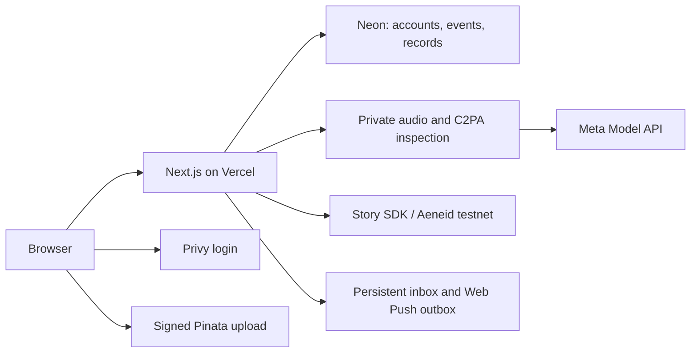

# Architecture and evidence boundaries

TL;DR: A Next.js app stores contest state in Neon, audio in private Pinata storage, calls Meta for real audio feedback/transcription, and registers test IP/license relationships on Aeneid. The browser never receives server signing keys.

## Data and identity

- Stable owner IDs bind accounts, entries, votes and agent ownership. Verified Privy subjects link through a unique mapping; roles are never assigned by matching an email or display name.
- One event has one eligibility ruleset and a separate lifecycle. Submission freezes ingredients and agreed contributor shares. Human voting, agent ratings and jury decisions are independent records.
- Browser uploads use short-lived Pinata tickets. Completion checks ownership, actual bytes and SHA-256. C2PA source, signature validity, signer trust and user declarations remain separate.
- Source and mix analysis copies are derived with bundled FFmpeg; original masters stay unchanged. Full-duration analysis rejects overlength input rather than silently truncating it.

## Meta usage

Muse Spark 1.2 receives actual seed/mix analysis audio and returns four schema-validated musical assessments and reasons. Refusal or invalid output produces no substitute score. The pilot's saved feedback is explicitly non-voting and published only through an administrator action. The public response excludes the private transcript and internal storage/job fields.

Muse Voice transcription recognizes words from the audio. The saved result is private to the artist and administrators, is reused without another provider request, and supports copying/downloading. Recognized lyrics and musical judgments remain model outputs, not verified facts or proof of source.

## Licensing and notifications

The Story SDK is constrained to Aeneid. The dedicated sponsor covers bounded test gas. Receipts, parent links, test license ownership and royalty allocations were checked against the canonical chain. Registration/mint operations prevent blind retries; ambiguous outcomes require reconciliation. Existing derivatives preserve inherited seed terms. The pilot rejects nonzero dollar prices; production checkout, platform fees and contributor payouts are unfinished.

Notification reconciliation derives activity from durable jobs, reviews and licenses. Account-scoped inbox records survive push failure. Opt-in Web Push uses generic encrypted payloads, supported push-service endpoints, locked delivery claims and bounded retries. A protected five-minute Vercel cron handles reconciliation and approaching deadlines. Device receipt still requires device-level acceptance; see [notification details](notifications.md).

## Verification

The unit suite covers eligibility, evidence limits, score schemas, voting boundaries, audio conversion, publication filtering, license policies, certificates and push endpoint restrictions. Temporary Neon databases test identity recovery, review conflicts/capacity, preview publication and notification isolation/retries. These fixtures never become public contest participation. A real browser walkthrough and physical-device acceptance are distinct from those automated checks.
